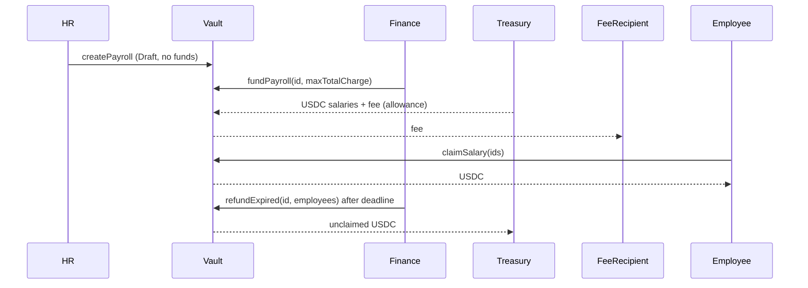

# ZalaryPayrollVault: Design Doc

> Implementation note (final spec): the shipped contract follows your detailed build spec where it differs from this plan. Funding pulls from the Finance wallet that calls `fundPayroll(bytes32)` (no separate treasury; refunds return to that wallet). `fundPayrollDirect` exists for an account holding both HR and Finance roles. `claimSalaryFor` is limited to the employee or a RELAYER_ROLE holder. `claimSalary()` claims up to 50 open payrolls per call. Admin can rescue only USDC surplus above escrow, never escrowed salaries.

## Metadata
- Status: Draft v2 (HR / Finance roles added, awaiting confirmation)
- Target chain: Arc Testnet (USDC, 6 decimals ERC-20 view). Testnet by default.
- Toolchain: Solidity ^0.8.28, Foundry, OpenZeppelin v5
- Built from: the pasted `ZalaryPayrollVault` source (kept as the base, completed and corrected)
- Reviews: [ ] Design  [ ] Security

## Action Items
- None yet.

## Goals / Non-Goals
Goals
- Institutional maker-checker payroll: HR prepares a payroll as an immutable draft, Finance reviews and funds it from the treasury. Neither can do the other's job.
- Employees pull their salary (themselves, or via a relayer that can only pay the employee).
- After the deadline Finance can return unclaimed salary to the treasury.
- A protocol fee is charged on top at funding time.
Non-Goals
- One organization per vault (no multi-tenant). No upgradeability, push payments, streaming, multi-token, or UI.

## Requirements
Functional
- F1 Prepare: HR submits payroll ID, deadline and per-employee amounts. The contract stores it as a Draft and computes the total on-chain. Nothing moves.
- F2 Cancel: HR or Finance can cancel a Draft. A funded payroll cannot be cancelled.
- F3 Fund: Finance funds a Draft. USDC (salaries plus fee) is pulled from the treasury wallet, the fee goes to the fee recipient, and the payroll becomes Funded. Finance passes a `maxTotalCharge` so a fee change between review and funding cannot surprise it.
- F4 Claim: an employee claims one or many Funded payrolls, once per allocation. Anyone may trigger it for them, funds always go to the employee.
- F5 Refund: after the deadline, Finance returns selected unclaimed allocations to the treasury.
Security (testable)
- S1 `USDC.balanceOf(vault) >= sum of remainingEscrow` at all times.
- S2 An allocation is paid at most once, to the employee or back to the treasury, never both.
- S3 HR can never fund, refund, or touch money. Finance can never create or edit allocations.
- S4 The account that prepared a payroll cannot be the account that funds it (even if it holds both roles).
- S5 Drafts are immutable: what Finance reviewed is exactly what gets funded.
- S6 Admin cannot move escrowed funds. Fee never exceeds 5% and never changes an already funded payroll.

## Terminology & Actors
| Actor | On/off-chain | Trust | Can do |
| --- | --- | --- | --- |
| HR | EOA/multisig | Semi-trusted | Prepare and cancel drafts |
| Finance | EOA/multisig | Semi-trusted | Fund drafts, cancel drafts, refund expired allocations |
| Treasury | Wallet (ideally multisig) | Trusted | Holds USDC and approves the vault; receives refunds |
| Employee | EOA | Untrusted | Claim own allocations |
| Relayer | Off-chain | Untrusted | Trigger a claim; funds go only to the employee |
| Pauser | EOA | Semi-trusted | Pause/unpause |
| Admin | multisig | Trusted | Grant/revoke roles, set fee, recipient and treasury (two-step, delayed admin handover) |

## Language / Runtime
Solidity ^0.8.28 (checked arithmetic). OpenZeppelin `AccessControlDefaultAdminRules`, `Pausable`, `ReentrancyGuard`, `SafeERC20`.

## Transaction & Execution Model
Every function is atomic. All state is updated before USDC leaves the vault (checks, effects, interactions) and every external-call function is `nonReentrant`.

## Architecture & Flow of Funds

| Step | Movement | Invariant |
| --- | --- | --- |
| createPayroll | none | status Draft, total computed on-chain, immutable |
| fundPayroll | treasury -> vault `total + fee`; vault -> feeRecipient `fee` | vault gains exactly `total`; `remainingEscrow = total` |
| claim | vault -> employee | allocation marked claimed, `remainingEscrow` drops |
| refund | vault -> treasury | allocation marked refunded, `remainingEscrow` drops |
Resting-state invariant: vault USDC equals total unclaimed, unrefunded escrow (S1).

## Contract Design
### Changes versus the pasted source (all deliberate)
1. Single "employer" split into HR (prepare) and Finance (fund/refund) with a Draft -> Funded lifecycle and the preparer-cannot-fund rule.
2. Payer is a configured `treasury` wallet, not the caller, so a Finance operator never needs to hold the money. Refunds return to the treasury.
3. Total is computed on-chain from the amounts (the pasted `totalAmount` argument and mismatch error are removed). `claimableBalance` is dropped; use the `pendingFor` view. This keeps funding O(1).
4. `claimSalary()` becomes `claimSalary(bytes32[] payrollIds)` (same for `claimSalaryFor`). The pasted aggregate claim could pay an allocation twice and made refunds unsafe.
5. `AccessControlDefaultAdminRules` (two-step, delayed admin handover). Separate pauser kept.
6. Fee recipient and treasury must be non-zero at deploy. 500-employee cap per payroll. `InvalidPayrollId` for a zero ID.

### Roles
| Role | Holder | Permissions |
| --- | --- | --- |
| DEFAULT_ADMIN_ROLE | admin multisig | Grant/revoke roles, `setProtocolFee`, `setTreasury` |
| HR_ROLE | HR operators | `createPayroll`, `cancelPayroll` |
| FINANCE_ROLE | Finance operators | `fundPayroll`, `cancelPayroll`, `refundExpired` |
| PAUSER_ROLE | admin initially | `pause`, `unpause` |
Admin holds neither HR nor Finance by default, so no single key can prepare and fund.

### Storage
`USDC` (immutable), `treasury`, `feeBps`, `feeRecipient`, `totalProtocolFeesCollected`; `payrolls[id]` (preparer, funder, deadline, status {None, Draft, Funded, Cancelled}, employeeCount, totalAmount, remainingEscrow, protocolFeePaid); `allocations[id][employee]` (amount, claimed, refunded); `totalClaimed[employee]`.

### Write functions
| Function | Caller | Reverts when | Events |
| --- | --- | --- | --- |
| `createPayroll(id, deadline, employees, amounts)` | HR, not paused | zero/used id, deadline not in future, empty/mismatched/over-500 arrays, zero address/amount, duplicate employee | `PayrollPrepared` |
| `cancelPayroll(id)` | HR or Finance | not Draft | `PayrollCancelled` |
| `fundPayroll(id, maxTotalCharge)` | Finance, not paused | not Draft, caller == preparer, deadline passed, charge > `maxTotalCharge` | `PayrollFunded`, `ProtocolFeeCollected` |
| `claimSalary(ids)` | employee, not paused | empty ids, payroll not Funded, no allocation, already claimed/refunded | `PayrollSalaryClaimed`, `SalaryClaimed` |
| `claimSalaryFor(employee, ids)` | anyone, not paused | as above, zero address | same, `claimer` = caller |
| `claimPayrollSalary(id)` | employee | as above | same |
| `refundExpired(id, employees)` | Finance, not paused | not Funded, before deadline, empty list, allocation missing/claimed/refunded | `LeftoverRefunded` |
| `setProtocolFee(bps, recipient)` | admin | bps > 500, zero recipient | `ProtocolFeeUpdated` |
| `setTreasury(addr)` | admin | zero address | `TreasuryUpdated` |
| `pause` / `unpause` | pauser | none | OZ events |

Views: `pendingFor(employee, id)`, `quoteCharge(id)` (total, fee, charge), public getters.

## Specification notes
Claims remain possible after the deadline until Finance refunds that allocation (employee-friendly: a late claim is not blocked, only a refund is final).

## Deployment & Initialization
Constructor `(usdc, admin, adminDelay, treasury, feeRecipient, feeBps)`. USDC address comes from Arc's registry, never typed by hand. After deploy the admin grants HR_ROLE and FINANCE_ROLE to the real operators, and the treasury approves the vault for USDC. On testnet the admin is the platform deployer wallet unless you name another. Not upgradeable, no proxy.

## Upgradeability
None. Migration story: deploy a new vault; existing payrolls finish on the old one (claims and refunds keep working there).

## Security Considerations
| Vulnerability | Applicable? | Mitigation |
| --- | --- | --- |
| Reentrancy | Yes (USDC transfers) | State first, `nonReentrant` on all transfer functions |
| Access control | Yes | Roles above; preparer != funder; refunds Finance-only |
| Overflow | Checked 0.8 | No `unchecked` blocks |
| Unchecked external call | Yes | `SafeERC20` |
| Fee-on-transfer tokens | No (USDC only) | Token fixed at deploy |
| Signature replay | N/A | No signatures |
| Front-running | Low | Only HR can create IDs, so no outside squatting; `maxTotalCharge` guards fee changes |
| Oracle / flash loan | N/A | None |
| Denial of service | Yes | Pull model, 500-employee cap, caller-supplied claim IDs |
| Delegatecall / proxy | N/A | Not upgradeable |
| Timestamp dependence | Yes | Deadline only; minute-level drift is irrelevant |
| Approval persistence | Yes | Treasury should approve only what it funds; the vault never holds approvals itself |
| Centralization | Yes | Admin cannot touch escrow; fee capped 5%; admin transfer two-step with delay |
| USDC blocklist | Yes | If an employee is blocklisted their claim reverts alone; others unaffected. A blocklisted treasury cannot receive refunds (accepted) |

## Trust Model & Threat Analysis
| Actor | Worst case if compromised | Mitigation |
| --- | --- | --- |
| HR key | Prepare a fraudulent draft | Cannot fund it; Finance reviews first; drafts are immutable |
| Finance key | Fund a bad draft; refund expired funds to treasury | Cannot create drafts, cannot fund its own; refunds only go to treasury |
| HR + Finance collusion | Fund a fraudulent payroll | Needs two distinct accounts; use multisigs and monitor `PayrollFunded` |
| Admin | Fee up to 5% on future payrolls, redirect treasury/fee recipient, grant roles | Fee cap, events, two-step delayed admin transfer |
| Pauser | Freeze claims and refunds | Separate role, revocable, no fund access |

## Emergency Response
Pause blocks preparing, funding, claims and refunds. No admin rescue of escrow (by design). Playbook: pause, investigate, unpause or migrate to a new vault.

## Failure Scenarios
- USDC transfer to an employee fails (blocklist): whole claim reverts, nothing marked claimed.
- Fee transfer fails: whole funding reverts.
- Treasury has insufficient allowance or balance: funding reverts, the draft stays a Draft.
- Fee raised after review: funding reverts via `maxTotalCharge`; Finance re-reviews.

## Priorities & Tradeoffs
| Decision | Tradeoff | Rejected alternative |
| --- | --- | --- |
| Claim by payroll IDs | Caller passes IDs | Aggregate balance (double-pay risk) or on-chain ID list (spam DoS) |
| Finance-only refunds to treasury | Lost Finance access delays refunds (admin can re-grant roles) | Admin pulling escrow (custody power) |
| Treasury pays, not the caller | Treasury approval is a standing risk | Caller pays (operators must hold funds) |
| Preparer != funder | A solo person with both roles is blocked | Role separation only (bypassable) |
| No upgradeability | New vault needed for changes | UUPS proxy |
| Pausing blocks claims | Employees wait during incident | Claims never pausable (larger exploit window) |

## Testing Strategy
Foundry unit, fuzz (fee math, sum accounting) and invariant tests (S1, S2), plus role-separation tests (S3, S4). Static analysis with Slither. Run `forge test`.

## Third-party Libraries
OpenZeppelin Contracts 5.x (already a project dependency, audited).

## Monitoring
Alert on `ProtocolFeeUpdated`, `TreasuryUpdated`, role grants, pause events, large `PayrollFunded`, and `LeftoverRefunded`.
